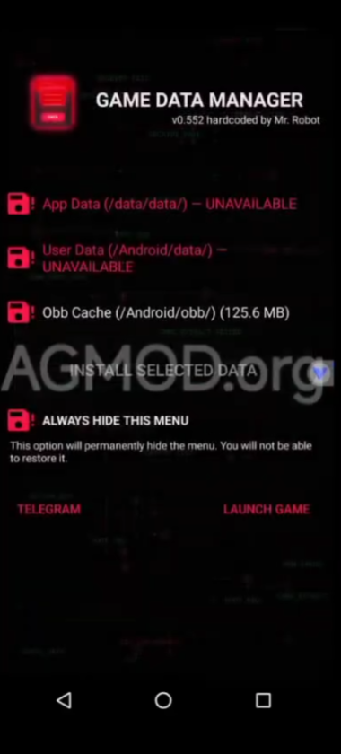
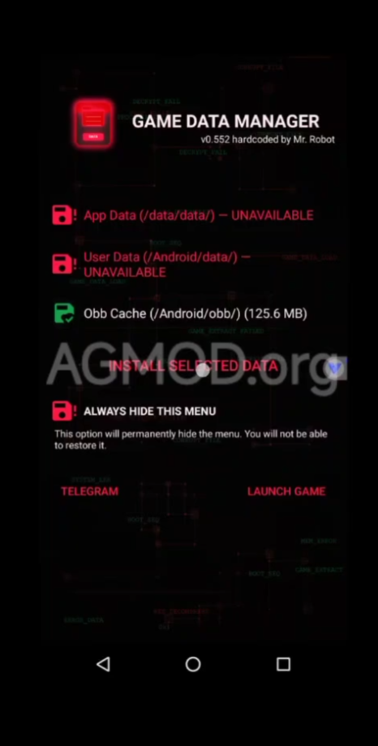
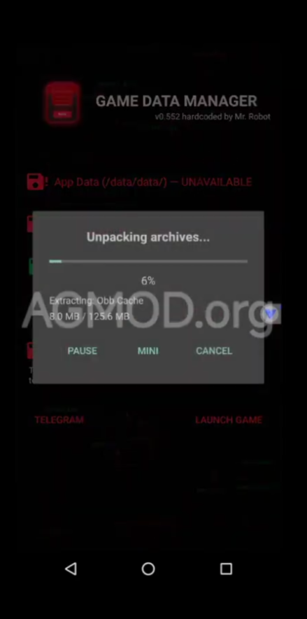
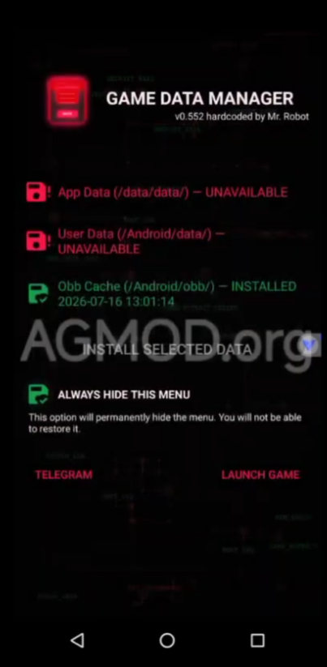

# Blood & Glory v1.1.6 — BGPad (Android 16 + manette)

Version modifiée de **Blood & Glory** (Glu, 2011), le jeu de gladiateurs retiré du Play Store depuis longtemps. Elle est pensée pour tourner sur les téléphones récents. Elle part de l'APK **[Blood & Glory v1.1.6 (Support Android 14) d'AGMOD](https://agmod.org/blood-glory-v1-1-6-support-android-14-apk/)** (lanceur « Game Data Manager » de Mr. Robot), qui ne fonctionnait plus au-delà d'Android 15. **Created with the help of Claude (AI)**

> **Téléchargement :** voir l'onglet [Releases](../../releases). Le fichier s'appelle `Blood & Glory v1.1.6 BGPad.apk`.

---

##  Nouveautés par rapport à la version d'origine

###  Compatibilité Android 16
- L'APK s'installe et se lance sur **Android 16 / One UI 8**. Avant, Android affichait « application non compatible ».
- Plusieurs plantages liés aux versions récentes d'Android sont corrigés.
- Le bug qui cassait la **sélection des tournois** (liste impossible à faire défiler, écran corrompu) et perturbait la **boutique** sur les processeurs récents est corrigé.
- Testé sur **Samsung Galaxy S22 (Android 16)**.

###  Plein écran
- Le jeu occupe **tout l'écran**, y compris la zone de la caméra (il n'y a plus de bande noire de ce côté).
- Sur les écrans très allongés, les bords non utilisés par les menus sont maintenant noirs, sans pixels parasites.

###  Rotation dans les deux sens
- Le jeu fonctionne en paysage **des deux côtés**. On peut retourner le téléphone, même si la rotation automatique est verrouillée.

### 🎮 Compatibilité manette
- **En combat :** compatibilité **complète**. Attaques au stick, esquives, bouclier, attaque spéciale, potions et pause se font tous à la manette.
- **Dans les menus :** compatibilité **fonctionnelle mais pas parfaite**. On navigue avec un curseur, déplacé au stick gauche ou de bouton en bouton au D-pad. Certains écrans restent plus pratiques au doigt (par exemple, faire défiler la liste des tournois).
- Le tactile reste utilisable à tout moment, en parallèle de la manette.
- Testé avec une **GameSir X2s** (disposition Xbox). Les autres manettes Bluetooth ou USB-C devraient fonctionner aussi.

### 💰 Nouveau système de récompenses (pièces d'argent)
Dans la version d'origine, les gains en pièces d'argent ne suivaient pas les prix de l'équipement en fin de partie. Sur les derniers tournois, il fallait repasser par les anciennes arènes pour gagner de quoi s'équiper (ou payer).

Les gains en pièces d'argent (combats **et** récompenses de fin de tournoi) sont maintenant **multipliés selon votre avancement** dans le jeu :

| Avancement | Multiplicateur |
|---|---|
| Premier tournoi | ×1 (inchangé) |
| Milieu du jeu | ×1,5 |
| ~80 % du jeu | ×2,3 |
| Dernier tournoi | ×3 |

La hausse est progressive (courbe quadratique) : le début du jeu reste presque identique et l'essentiel du bonus arrive vers la fin.

> **À savoir :** sur les derniers tournois, le bonus est peut-être un peu généreux. C'est voulu. Ça laisse une marge pour régler soi-même la difficulté : on peut dépenser tout de suite dans le meilleur équipement, ou garder son argent pour un défi plus relevé. L'augmentation reste raisonnable, sans casser la progression.

### 💾 Sauvegarde
- À chaque lancement, une copie de votre sauvegarde est faite automatiquement dans `Android/data/com.glu.gladiator/files/savegame_export.bin`.
- Pour transférer une partie d'un autre téléphone, placez le fichier dans ce même dossier sous le nom `savegame_import.bin`. Il sera importé au lancement suivant, et l'ancienne sauvegarde est conservée.

---

## 🕹️ Commandes manette

### En combat

| Bouton | Action |
|---|---|
| **Stick droit** | Attaquer : poussez le stick dans une direction, comme un glissé du doigt |
| **Stick gauche** | Attaquer (même principe) |
| **LB** ou **LT** | Esquive à gauche |
| **RB** | Esquive à droite |
| **A** ou **RT** (maintenu) | Bouclier |
| **X** | Attaque spéciale |
| **Y** ou **Select** | Ouvrir le menu des potions |
| ↳ puis **LB** / **X** / **RB** | Potion de soin / d'attaque / de protection |
| **A** | Passer les cinématiques |
| **Start** | Pause |

> En mode manette, le jeu affiche les symboles PlayStation de l'époque (□ ○ ✕ △) : □ = LB, ○ = RB, ✕ = A, △ = X.

### Dans les menus

| Bouton | Action |
|---|---|
| **Stick gauche** | Déplacer le curseur |
| **D-pad** | Sauter de bouton en bouton |
| **A** | Valider |
| **B** | Retour |

---

## 📥 Installation

1. **Désinstallez** toute autre version de Blood & Glory. La signature est différente, donc l'installation par-dessus est impossible. ⚠️ Pensez à récupérer votre sauvegarde avant (voir plus haut).
2. Installez `Blood & Glory v1.1.6 BGPad.apk`. Autorisez l'installation depuis des sources inconnues si Android le demande.
3. Lancez le jeu et suivez le petit tutoriel ci-dessous (**à faire une seule fois**).

### 🛠️ Premier lancement : installer les données du jeu (OBB)

Au premier lancement, le **Game Data Manager** s'affiche pour installer les données du jeu.

| 1. L'écran apparaît | 2. Sélectionnez « Obb Cache » | 3. Installation en cours | 4. Masquez le menu |
|:---:|:---:|:---:|:---:|
|  |  |  |  |

1. Le **Game Data Manager** s'ouvre au premier lancement.
2. Appuyez sur la ligne **Obb Cache** pour la sélectionner (l'icône devient verte), puis sur **INSTALL SELECTED DATA**.
3. Une fenêtre **« Unpacking archives… »** s'affiche : attendez la fin de l'extraction. La ligne passe alors à **INSTALLED**.
4. Cochez **ALWAYS HIDE THIS MENU**, sinon ce menu réapparaît à chaque lancement. Appuyez ensuite sur **LAUNCH GAME**.

Ensuite :
- accordez la permission **« Téléphone »** quand elle est demandée. Elle est **indispensable** : sans elle, le moteur du jeu (2011) plante sur Android 10 et plus. Elle ne sert à rien d'autre ;
- Android peut afficher « Cette appli a été conçue pour une ancienne version d'Android » : appuyez sur **OK**.

### Compatibilité
- Il faut un appareil qui exécute encore les **applications 32 bits** (`armeabi-v7a`). C'est le cas de la plupart des Samsung, dont le Galaxy S22. En revanche, certains téléphones récents sont 64 bits uniquement (Google Pixel 7 et plus récents, par exemple), et le jeu **ne peut pas** y fonctionner. Ce n'est pas corrigeable : le moteur Unity de 2011 n'existe qu'en 32 bits.

---

## 🐞 Problèmes connus
- Les flèches ▲▼ de la liste des tournois ne répondent pas. Faites défiler la liste en glissant le doigt.
- La navigation à la manette dans les menus reste imparfaite (voir plus haut).

## Et ensuite ?
**D'autres mises à jour arriveront.** Corrections, améliorations de la navigation à la manette dans les menus, ajustements… N'hésitez pas à ouvrir une *issue* pour signaler un bug ou proposer une idée.

---

## ⚠️ Avertissement
Projet de fan, sans but lucratif, sans aucun lien avec Glu Mobile ni Electronic Arts. *Blood & Glory* et tous les éléments du jeu appartiennent à leurs propriétaires respectifs. Ce mod sert uniquement à préserver un jeu qui n'est plus disponible ni maintenu.

**Crédits :** Glu Mobile (jeu original) • [AGMOD](https://agmod.org/blood-glory-v1-1-6-support-android-14-apk/) (APK de base *v1.1.6 Support Android 14*) • Mr. Robot (Game Data Manager) • modifications BGPad. • Created with the help of Claude (AI)
